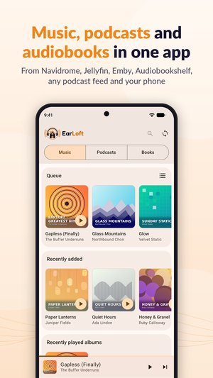
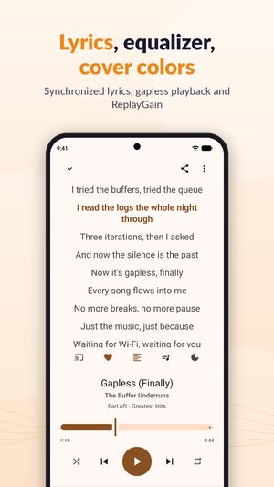
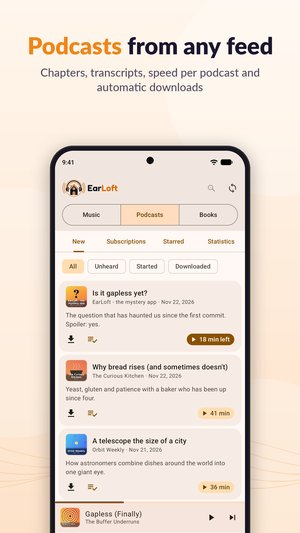
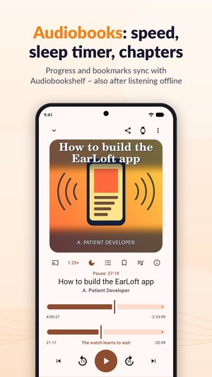
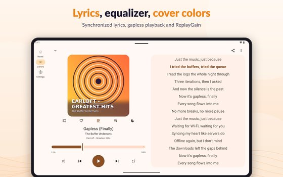
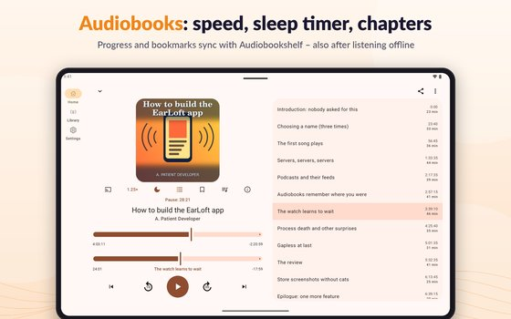
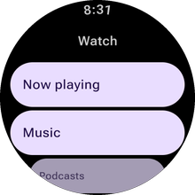
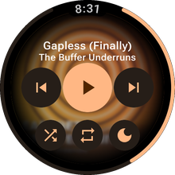

# EarLoft

[](LICENSE)


**EarLoft** is an audio player for your *own* collection: **music**, **podcasts** and **books**. It plays the
files on your phone together with your self-hosted music server ([Navidrome](https://www.navidrome.org),
[Jellyfin](https://jellyfin.org) or [Emby](https://emby.media)) and your
[Audiobookshelf](https://www.audiobookshelf.org) server in **one app** – on your phone, on your Wear OS watch and in
Android Auto. Podcasts come straight from their public RSS feeds. No streaming subscription, no account with a third
party.

Why do you need yet another media player? Well, you don't. I built this app primarily for myself, because this is the way
I like to listen to music, podcasts and audiobooks. There are a lot of good apps that deliver a fantastic experience in
one or two of these areas, but not in all three. Or they want subscription money. Or, if they do cover all three, they
don't support Android Auto or Wear OS, or they can't keep all your media offline on the watch. That's why this app
exists.

<p>
  <a href="fastlane/metadata/android/en-US/images/phoneScreenshots/1_library.png"></a>
  <a href="fastlane/metadata/android/en-US/images/phoneScreenshots/2_player.png"></a>
  <a href="fastlane/metadata/android/en-US/images/phoneScreenshots/3_podcasts.png"></a>
  <a href="fastlane/metadata/android/en-US/images/phoneScreenshots/4_audiobooks.png"></a>
</p>
<p>
  <a href="fastlane/metadata/android/en-US/images/tenInchScreenshots/2_player.png"></a>
  <a href="fastlane/metadata/android/en-US/images/tenInchScreenshots/4_audiobooks.png"></a>
  <a href="fastlane/metadata/android/en-US/images/wearScreenshots/1_watch_home.png"></a>
  <a href="fastlane/metadata/android/en-US/images/wearScreenshots/4_phone_playback.png"></a>
</p>

*Phone, 10-inch tablet and Wear OS watch. Click a screenshot to see it in full size.*

## Features

Three main areas: **Music**, **Podcasts** and **Books**. Each has a home view that shows what's new, and your complete
library.

### Everywhere

- **Offline listening.** Download music, podcasts and books; everything you browse comes from a local database, and
  covers and pictures are kept on the device as well, so the app stays usable without a connection.
- **Search** across all three areas or only the selected one, ignoring accents ("Bjork" finds "Björk").
- **Material 3 design** in the colors of the logo or, if you like, of your wallpaper (Material You); album pages take
  their colors from the cover, and the player can follow the cover or the app colors (**Settings → General**). Light,
  dark or following the system, phone and tablet layouts. Available in English, German, French, Spanish, Italian,
  Portuguese (Brazil and Portugal), Dutch, Polish, Swedish, Danish, Norwegian, Finnish and Czech.
- **Home screen widgets** (4×1) with cover and playback controls. Each widget gets its own areas and colors when you
  add it, and shows up to three lines of title when you pull it taller.
- **Chromecast** (see [Known limitations](#known-limitations)).
- **Sleep timer** with a duration or to the end of the chapter or episode. For books and podcasts, shake the phone to
  extend it.
- **Notifications about new content:** new albums, episodes and books, each area with its own notification (and
  notification channel). Tapping it opens the album, podcast or book directly.
- **Share** songs, albums, artists, podcasts and books as links to open sources (MusicBrainz, the podcast's
  website and feed, Open Library), never to your own servers; books and episodes from the current position. Feed links
  shared from other apps open as a podcast preview.
- **Backup to a file** (**Settings → General → Backup**): servers, subscriptions, playlists, progress, statistics and
  all settings in one file you keep yourself, to move to a new phone or start over. Passwords, API keys and sign-ins
  are never part of it; you enter them again after restoring. Restoring adds what is missing and replaces the settings.

### Music

- **One library, no duplicates.** A song on your phone *and* on your server shows up once; the app picks the best
  source (device file, download, then stream). **Track info** in the player shows where a song plays from.
- **Gapless playback** and **ReplayGain**, so live albums play without breaks and all albums at a similar volume. The
  system equalizer opens right from the player.
- **Browse the way you like:** by genre (a song can have several) and by decade; filter and sort the albums (also by
  cover color), then play or shuffle what is left.
- **Albums the way you like to see them:** a grid in three tile sizes (pinch to switch), a list, shelves grouped the way
  the albums are sorted (letter, artist, decade, last played, cover color), or a carousel and a record crate to flip
  through, where a dice button jumps to a random album.
- **Mixes:** **Start mix** on a song, album, artist or in the player queues similar songs. With **Keep playing**
  (**Settings → Music**) a mix is added when the last song of the queue starts, so the music never stops.
- **Favorite songs, albums and artists, playlists and play counts sync with your server**, also offline; scrobbling is
  supported. Playlists can be reordered, and the queue can be saved as a playlist.
- **Automatic downloads** of your favorites (favorite albums in full, favorite artists if you want), of the newest and
  of the most played albums, each with the number of albums you choose.
- **Statistics** in the library: what you listened to, and how much.
- **Synchronized lyrics** from your files or your server, or, if you switch it on, from [LRCLIB](https://lrclib.net).
- **Mobile data friendly:** over mobile data the app can stream a converted Opus file instead of the original
  (**Settings → Music**), and the next tracks are loaded ahead.

### Podcasts

- **Find podcasts** in Apple Podcasts, Podcast Index and ARD Sounds, or add any RSS or Atom feed directly. Before you search, **Add
  podcast** shows popular podcasts by category. The directories are off until you switch them on, because your search
  terms are sent to them. Shows from ARD Sounds without their own feed can be subscribed directly. Feeds refresh
  automatically in the background; moved feeds are followed, and feeds that keep failing are listed in the settings.
- **Protected feeds** ask for username and password; both stay encrypted on your device and are only sent to that
  feed's server.
- **Try before you subscribe:** listen to and download podcasts without subscribing. Subscriptions you no longer
  follow can be archived instead of deleted, so you keep their listening statistics.
- **Continue listening** is an editable queue: the next episode starts when one ends.
- **Everything the feed offers:** chapters (also from Podlove, with images and links), show notes with clickable
  timestamps, searchable transcripts, seasons, people and funding links.
- **Episode lists that keep up:** filter and sort, star episodes to find them again, see what you played recently,
  select several (or all) to download, queue or mark them, and swipe to queue or mark a single one.
- **Sound per podcast:** speed, shorten silence, boost volume, skip intro and outro, as a default for all podcasts, per
  podcast or per episode. The statistics show how much time shortening silence saved you.
- **Downloads** per episode, with a number of new episodes kept ready per podcast, deleting heard ones after a while,
  and resuming interrupted downloads. The file of a downloaded episode can be shared.
- **Podcast files on your phone** (folder **Podcasts**) show up as podcasts. Their features are limited, though, so I
  wouldn't listen to podcasts this way.
- **Import and export** your subscriptions as OPML, or subscriptions, progress and listening time as a database file.
- **Statistics:** listening time per podcast and per month.
- **Database export and import:** compatible with the great AntennaPod, so you can always switch back to the app you
  prefer. ARD Sounds and archived subscriptions come along.

### Books

- **From your Audiobookshelf server, from ARD Sounds and from your phone.** All libraries of your Audiobookshelf
  server are synced. Books on your phone (folder **Audiobooks**, m4b with chapters or folders of MP3 files) show up
  next to the ones from your server; like Audiobookshelf, the app reads folder names and, if you allow it, `cover.jpg`,
  `desc.txt`, `reader.txt` and `metadata.opf`.
- **Audiobooks and radio plays from ARD Sounds** (off by default, **Settings → Books → ARD Sounds**): browse, search,
  play and download them, follow shows under **My series** to get their new books, download books shortly before ARD
  withdraws them, or upload a book to your Audiobookshelf server to keep it.
- **Sign in with an API key or with OpenID** (for example through your single sign-on); the access token is renewed
  automatically, also for the watch.
- **Progress and bookmarks sync both ways** with your Audiobookshelf server, also after listening offline. All
  bookmarks of your books (or episodes) are on one page, opened from the library.
- **Made for long listening:** speed, shorter silence and volume boost per book, adjustable jumps (default −10 s /
  +30 s, also for podcasts), chapters, remaining time, rewinding after a pause. If you stopped within the first 30 s
  of a chapter, playback resumes at its beginning. In the notification and in Android Auto the buttons can skip or jump
  between chapters.
- **Browse by series, authors and genres**, sort and filter; an author page shows the description and the books by
  series. Translators are not listed as authors.
- **Automatic downloads** of the books you are listening to and of the next volume of a series, and deleting the
  downloads of finished books after a while. If you like, the app asks before streaming over mobile data.
- **Statistics** from your Audiobookshelf server, next to the listening time counted on this device.

### Your sources

- **Navidrome and other Subsonic servers (music).** Add one or more [Navidrome](https://www.navidrome.org) servers
  (OpenSubsonic API; other Subsonic-compatible servers should work but are not actively tested). Sign in with your
  username and password; the password is stored encrypted with the Android Keystore.
- **Jellyfin and Emby (music).** Add a [Jellyfin](https://jellyfin.org) or [Emby](https://emby.media) server with
  your username and password. Only the music libraries are used, and the app keeps the sign-in token, not the password
  (tested with Jellyfin 12.4 and Emby 4.10).
- **Audiobookshelf (books).** Add your [Audiobookshelf](https://www.audiobookshelf.org) server with an API key or sign
  in with OpenID, if your server offers it.
- **Podcast feeds.** Any public RSS or Atom feed, and feeds protected by username and password.
- **ARD Sounds (podcasts and books).** Shows, audiobooks and radio plays of the German public broadcasters. ARD Sounds
  has no official interface for apps, so this may stop working at any time.
- **Your phone.** Music from the device, books from the **Audiobooks** folder and podcasts from the **Podcasts**
  folder. Each is off until you switch it on in the settings; only then does the app ask for access to your audio
  files.

Servers at home (`http://192.168.x.x`) work too. The app warns you before using an unencrypted connection.

### Artist photos, album covers, author pictures and lyrics (optional, off by default)

Missing pictures and lyrics can be filled in from the internet. These options are **off by default** because they
send names to third parties, and you can switch them on in **Settings → Music** (author pictures in **Settings →
Books**):

- **Artist photos** from [Deezer](https://www.deezer.com) (artist names are sent).
- **Missing album covers** from [MusicBrainz](https://musicbrainz.org) and the
  [Cover Art Archive](https://coverartarchive.org) (album title and artist are sent).
- **Missing author pictures** from [Audnexus](https://api.audnex.us) (author names are sent).
- **Missing or synced lyrics** from [LRCLIB](https://lrclib.net) (song title, artist and length are sent).

Covers and lyrics embedded in your files or provided by your server are always used first.

### On your watch (Wear OS)

- **Music, podcasts and books without your phone.** Tap the watch icon on an album, a playlist, the favorites, an
  episode or a book (or choose **Load onto watch**), on the phone or on the watch under **Phone**. The watch downloads
  them by itself over Wi-Fi directly from your server, the podcast feed or ARD Sounds, or receives them from the phone
  (files stored on the phone, or when the server is not reachable). The favorites include your favorite albums.
  Running downloads show up on the watch face.
- **Play to Bluetooth headphones**, perfect for running or the gym. The watch speaker is not used. Books and podcasts
  have chapters, a sleep timer and the jump steps set on the phone; progress and listening time go back to the phone
  and from there to Audiobookshelf.
- **Two areas:** **Watch** lists what is on the watch (music, podcasts, books, storage & downloads); **Phone** shows
  the phone's music (including favorite albums and artists), podcasts and books, to play them on the phone or to load
  them onto the watch, and controls the phone's playback, with the chapters of the book or episode playing there.
- **Watch quality:** by default songs are converted by the server to Opus 128 kbit/s to save space on the watch;
  you can choose the original files instead. Changing the setting affects new downloads only. Podcasts and books are
  loaded as they are.
- **Storage & downloads** on the watch shows what is loaded and frees space: single entries, one area or everything.

### Android Auto

Android Auto support is included and works fine with my car. So far this is the only real car I could test it with.

- **Music, podcasts and books**, each area as its own tab next to **Recent**, which shows the latest of every area.
  Areas you switched off in the app are left out.
- Albums, podcasts and books as a grid with covers; episodes and books show their progress and whether they are
  downloaded. Favorite albums and artists are listed above the favorite songs.
- **Search** across all areas you use, a favorite button for songs, and chapter buttons for books and episodes if you
  choose them (**Settings → Books**).
- Changes on the phone (new songs, a new queue) show up in the car right away.

## Privacy

The full privacy policy is in [PRIVACY.md](PRIVACY.md) (German: [PRIVACY.de.md](PRIVACY.de.md)) and in the app under
**Settings → About → Privacy policy**. In short:

- Your library, listening history and settings stay on your device and on your own server.
- The app contacts only the servers and podcast feeds you add (and the sites that host their episodes and images). The
  only exceptions are the optional services you switch on yourself: the podcast directories and their popular
  podcasts (your search terms, country and language are sent), ARD Sounds, and the artwork and lyrics lookups
  described above.
- Server passwords, API keys, feed passwords and sign-in tokens are stored encrypted with the Android Keystore. The
  OpenID sign-in runs in your browser; EarLoft only receives the tokens from your Audiobookshelf server. Android
  backups contain your settings and what no server knows (your servers without their passwords, subscriptions,
  progress, local playlists and listening statistics), but never the library database, downloads or credentials. The
  same goes for the backup file you create yourself. Feed addresses are kept as they are, so a personal key in the
  address of a paid feed is part of the backup.
- There are no ads and no analytics.

## Permissions

EarLoft asks for three permissions, each only when it is needed, and works with whatever you allow. You can refuse each of them and change your
mind later under **System settings → Apps → EarLoft → Permissions** (or **→ Notifications**). The app does not ask for
location, microphone, camera, contacts, phone or Bluetooth access.

### On the phone

**Music and audio** (`READ_MEDIA_AUDIO`; on Android 8–12 *Files and media*, `READ_EXTERNAL_STORAGE`)

- *Asked:* when you switch on **Use music on this device** (**Settings → Music**), **Use podcasts on this device**
  (**Settings → Podcasts**) or **Use books on this device** (**Settings → Books**). All three are off by default.
- *Used for:* reading the music on your phone and the **Audiobooks** and **Podcasts** folders.
- *If you don't allow it:* the switch stays off and EarLoft works with your servers and podcast feeds only. Music,
  books and podcasts stored on the phone don't show up and can't be played or loaded onto the watch from the phone.
  Once Android stops showing the dialog after a refusal, the app opens its system settings page instead. If you take
  the permission away later while a switch is on, the app shows a page to allow it again or to continue without music
  on this device.

**Notifications** (`POST_NOTIFICATIONS`, Android 13 and newer)

- *Asked:* in the setup at the first start, when you tap **Allow notifications**.
- *If you don't allow it:* no notifications about new music, episodes and books, and no progress notifications for
  downloads and transfers to the watch (the downloads and transfers still run). The playback controls in the
  notification shade and on the lock screen keep working, because Android exempts media playback from this
  permission. If only some notifications bother you, switch off single channels instead (*New music*, *New episodes*,
  *New books*, *Downloads*, *Transfers to the watch*).

**Devices on your local network** (`ACCESS_LOCAL_NETWORK`, Android 17 and newer)

- *Asked:* when you save a server, and by itself as soon as a server or podcast feed in your home network is set up
  without it (for example after restoring a backup or on a new phone). A server on the phone itself needs no
  permission.
- *Used for:* reaching servers and podcast feeds in your home network, for example `http://192.168.x.x`.
- *If you don't allow it:* connections to addresses in your home network time out, so syncing, streaming and
  downloading from them fail and adding a server ends with a connection error. Such a server or feed says *access to
  the home network not allowed* and offers the app settings; once you allow it there, it is synced again right away.
  Servers and feeds you reach over the internet (public address) are not affected.

### On the watch

**Devices on your local network** (`ACCESS_LOCAL_NETWORK`, watches with Android 17 / API 37 and newer)

- *Asked:* when the watch app starts.
- *If you don't allow it:* the watch can't download directly from servers in your home network. After a few failed
  attempts it asks the phone instead, which can only send what it stores itself (files on the phone and downloads);
  everything else stays "failed". Podcasts and servers reached over the internet still load directly.

**Notifications** (`POST_NOTIFICATIONS`, watches with Android 13 / API 33 and newer)

- *Asked:* when the watch app starts, after the local network permission.
- *If you don't allow it:* running downloads show no notification and no icon on the watch face, so tapping it can't
  open *Storage & downloads*; the downloads themselves still run. The watch does not ask for any other permission.

### Granted without asking

Android grants these at installation; they can't be refused and are listed for completeness: internet and network
state (servers, feeds, "Wi-Fi only" downloads; the watch also requests Wi-Fi for downloads), foreground services for
playback and downloads, keeping the device awake during playback and downloads, and restarting scheduled background
work (feed refresh, sync, downloads) after a reboot.

## Installation

EarLoft is not yet available in an app store. Build it yourself (see [Building from source](#building-from-source));
or download it from the [Releases page](https://github.com/TinyScripter/EarLoft/releases).

**Requirements:** Android 8.0 or newer (phone), Wear OS 3 or newer (watch). The phone and watch app share one
application ID (`de.kleinabersmart.earloft`), so install both for the watch features. The watch app is set up from the
phone and does not work without it.

## Getting started

1. Open the app. At the first start a short setup guides you through the sections you want (music, podcasts, books),
   their sources (servers, subscriptions, files on this device, images from the internet), notifications, the watch and
   the appearance. Its first page offers to restore a backup, its podcast page to import a podcast database. You can
   skip it at any time and open it again under **Settings → General → Show setup again**. The steps below do the same
   by hand. Access to your audio files is only asked for when you switch on music, podcasts or
   books on this device, access to your local network (from Android 17) when you add a server or one in your home
   network is already set up. See
   [Permissions](#permissions) for what each one is needed for.
2. **Music:** switch on **Settings → Music → Use music on this device** for the music on your phone. For a server:
   **Settings → Music → Add server**, choose the server type (Navidrome / Subsonic, Jellyfin or Emby), then enter the
   address (for example `https://music.example.com`) and your credentials. The first sync can take a while for large
   libraries.
3. **Podcasts:** switch to **Podcasts** on Home or Library and tap **Add podcast**, then search a directory or paste
   the feed address. Or copy podcast files into the **Podcasts** folder of your phone and switch on **Settings →
   Podcasts → Use podcasts on this device**.
4. **Books:** **Settings → Books → Add server**, then enter your Audiobookshelf address and either tap **Sign in with
   OpenID** (shown when your server offers it) or enter an API key (created in Audiobookshelf under *Settings → API
   Keys*). If your default browser can't hand the sign-in back to the app, EarLoft tells you which address to add in
   Audiobookshelf under *Settings → Authentication → Allowed Mobile Redirect URIs*. Or just copy books into the
   **Audiobooks** folder of your phone and switch on **Settings → Books → Use books on this device**. For audiobooks and
   radio plays from ARD Sounds, switch on **Settings → Books → ARD Sounds**.
5. Play something. On an album, playlist, book or episode you can download it (download arrow) or load it onto your
   watch (watch icon). Downloads are listed under **Settings → General → Downloads**; the watch is managed under
   **Settings → Watch** (shown once a watch with EarLoft is paired).

## Known limitations

- Chromecast plays from your servers and podcast feeds. Files stored only on the phone are sent by the phone itself, so
  the phone has to stay in the same Wi-Fi as the Cast device. For everything else, the Cast device must reach the
  server address itself. If a song is on several servers and the Cast device cannot reach the first one, the app
  switches to the next one after about 20 seconds. Long queues are sent in parts. Casting books depends on the server
  accepting a token in the address and has not been tested widely (with an OpenID sign-in not at all).
- Local podcast files have no description unless their tags contain one.
- ARD Sounds is used through an unofficial interface that may change or stop working. Uploading a book from ARD Sounds
  to Audiobookshelf runs while the app is open and stops when you close it.
- Local books and podcasts are picked up when the app is opened or refreshed, not while it is running.
- Lyrics from `.lrc` files next to your music and a folder view are not supported, because Android does not let apps
  read arbitrary folders without a folder permission. Embedded lyrics and server lyrics work.

## Designed and tested by me, coded by Claude
The whole App has been coded with Claude Code. All final tests were made by me on my Pixel 10 Pro, Pixel Watch 3 and
Galaxy Tab S8.

---

# For developers

## Tech stack

| Area | Technology |
|---|---|
| Language / build | Kotlin 2.4, Gradle 9.8 (wrapper), Android Gradle Plugin 9.6 (alpha, R8 pinned to an earlier alpha), version catalog, convention plugins in `build-logic` |
| Phone UI | Jetpack Compose (BOM 2026.09), Material 3, Navigation 3, MaterialKolor |
| Wear UI | Compose for Wear OS Material 3 |
| Playback | Media3 1.11: ExoPlayer, `MediaLibraryService`, `OkHttpDataSource`, `SimpleCache`, Cast |
| Database | Room with FTS4 search and auto-migrations |
| Network / images | OkHttp 5, kotlinx.serialization, Coil 3; Subsonic, Jellyfin/Emby, Audiobookshelf and RSS/Atom (own XML parser) |
| DI | Hilt |
| Background work | WorkManager (sync queue, downloads, offline images) |
| Secrets / sign-in | Android Keystore (AES-GCM) + DataStore; Auth Tab (AndroidX Browser) with PKCE for the Audiobookshelf OpenID sign-in |
| Widget | Jetpack Glance |
| Phone ↔ watch | Wearable Data Layer (`DataClient`, `MessageClient`, `ChannelClient`) |

SDK levels: `minSdk` 26 (phone) and 30 (watch), `compileSdk` / `targetSdk` 37, Java 17.

## Architecture in short

- **Local database as single source of truth.** The UI only reads from Room; network access runs in the background.
- **Logical song vs. physical source.** A `songs` row is the song the user sees; each file or server entry is a
  `song_sources` row. A merge resolver (MusicBrainz IDs, then normalized artist/album/title) joins them across sources.
- **Sources are resolved at load time.** Queue items only carry `earloft://song/<id>`; a `ResolvingDataSource` decides
  between local file, download and stream when playback starts, so queues survive downloads finishing or servers
  going offline.
- **One `OkHttpClient`.** Interceptors add the server authentication (Subsonic, Jellyfin/Emby, Audiobookshelf), so
  stream and cover URLs stay stable and cacheable and contain no secrets. An expired Audiobookshelf access token is
  renewed once, even when several requests fail at the same time.
- **Offline changes** (favorites, playlists, scrobbles) go through a sync queue that coalesces actions and retries
  with backoff.
- **Images are kept offline.** After each library change a worker loads missing covers, podcast and author pictures
  over Wi-Fi into app storage (outside the cache) and removes the ones no longer needed.
- **Books and podcast episodes share one model.** Both are `books` rows (`kind = BOOK` or `EPISODE`) with files, chapters
  and a progress entry; a position in the whole book is converted to a file and offset when playback starts. The same
  player service, download workers and "continue listening" logic serve both.
- **Browse tree for Android Auto and the system media controls** comes from one `MediaLibraryService`, split by area
  (music, podcasts, books). The watch app has its own player and database and talks to the phone over the Wearable
  Data Layer.

## Project structure

```text
:app                  Phone UI, navigation, widget, Cast, notifications, DI wiring
:wear                 Wear OS app (standalone downloads and playback, remote control of the phone)
:core:model           Plain Kotlin data classes
:core:common          Dispatchers, normalization, shared helpers
:core:database        Room entities, DAOs, FTS, migrations
:core:network         OkHttp client, Subsonic / Jellyfin / Emby / Audiobookshelf APIs (incl. OpenID), podcast feed parser
:core:datasource      Local (MediaStore: music, Audiobooks, Podcasts), Subsonic and Jellyfin/Emby data sources
:core:data            Repositories (music, books, podcasts), library syncer, merge resolver, sync queue, search, offline images
:core:download        Download workers (songs, books, episodes), resumable transfers, storage
:core:playback        Media library service, ReplayGain, source resolution, book/episode playback, Auto browse tree
:core:designsystem    Theme and shared phone components
:core:wearsync        Phone ↔ watch protocol
build-logic/          Convention plugins
```

## Building from source

### Prerequisites

- A recent **Android Studio** that supports the Android Gradle Plugin version in
  [`gradle/libs.versions.toml`](gradle/libs.versions.toml). The project currently uses an AGP 9 alpha, so you may need
  a Canary build of Android Studio. R8 is pinned to an earlier version in the root `build.gradle.kts`, because newer
  R8 alphas produce release builds that crash at startup; check a release build before raising it.
- **JDK 17 or newer** (the build targets Java 17; the Gradle wrapper downloads Gradle itself).
- **Android SDK Platform 37** and current build tools (Android Studio offers to install them).
- For the watch: a Wear OS device or emulator (API 30+). For the phone: Android 8.0+ (API 26+).

### Build

```bash
git clone https://github.com/TinyScripter/EarLoft.git
cd EarLoft

./gradlew :app:assembleDebug      # phone APK  -> app/build/outputs/apk/debug/
./gradlew :wear:assembleDebug     # watch APK  -> wear/build/outputs/apk/debug/
```

Install on a connected device or emulator:

```bash
./gradlew :app:installDebug
./gradlew :wear:installDebug
```

Phone and watch app share the application ID, so with both a phone and a watch connected, choose the device with
`ANDROID_SERIAL` (for example `ANDROID_SERIAL=emulator-5554 ./gradlew :app:installDebug`); otherwise Gradle installs
the phone app on the watch too.

If Gradle cannot find the SDK, create `local.properties` in the project root with `sdk.dir=/path/to/Android/Sdk`
(Android Studio does this for you).

The release builds come with a Podcast Index key. In your own build, the podcast directory Podcast Index is only offered
if you add your own [Podcast Index API key](https://api.podcastindex.org) to `local.properties` (`podcastindex.key` and
`podcastindex.secret`); otherwise it is missing from the settings. fyyd needs no key and is offered in every build
(`fyyd.enabled=false` leaves it out).

### Tests

```bash
./gradlew testDebugUnitTest :core:model:test :core:common:test   # unit tests of all modules
```

### Release build and signing

Release builds are optimized with R8. To sign them, create `keystore.properties` in the project root (it is not
checked in):

```properties
storeFile=/path/to/your.jks
storePassword=...
keyAlias=...
keyPassword=...
```

Without this file `release` builds still run, but the APK stays unsigned.

Phone and watch share one version, set in [`gradle.properties`](gradle.properties) (`VERSION_MAJOR`, `VERSION_MINOR`,
`VERSION_PATCH`, `VERSION_TYPE` = `beta`, `rc` or `release`, `VERSION_BUILD_NUM`). The build derives `versionName`
(for example `1.5.0-beta01`) and `versionCode` from it; the first digit of the `versionCode` is `1` for the phone and
`2` for the watch, so both can be published in the same store listing.

```bash
./gradlew :app:assembleRelease :wear:assembleRelease
```

### Trying it with a local Navidrome (or Audiobookshelf)

Any Navidrome instance works. For an emulator, start Navidrome on your computer and forward the port, so the app can
use `http://127.0.0.1:4533`:

```bash
adb reverse tcp:4533 tcp:4533
```

Audiobookshelf works the same way, with its own port (by default `13378`).

## Contributing

Bug reports and ideas are welcome in the
[issue tracker](https://github.com/TinyScripter/EarLoft/issues). For code changes, please open an issue first
to discuss them and make sure unit tests pass (see [Tests](#tests)).

## License

EarLoft is free software, licensed under the **GNU General Public License v3.0**. You can redistribute it and/or
modify it under the terms of the GPLv3 as published by the Free Software Foundation. The full text is in
[LICENSE](LICENSE).

This program is distributed in the hope that it will be useful, but **without any warranty**; without even the implied
warranty of merchantability or fitness for a particular purpose. See the
[GNU General Public License](https://www.gnu.org/licenses/gpl-3.0.html) for more details.

Third-party libraries keep their own licenses; the list is shown in the app under **Settings → About → Licenses**.
